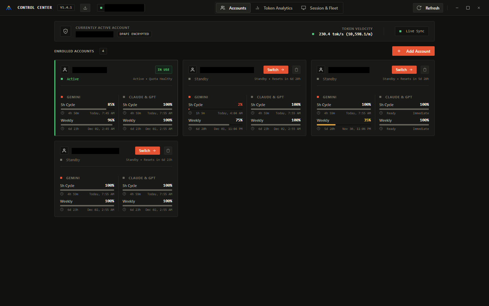
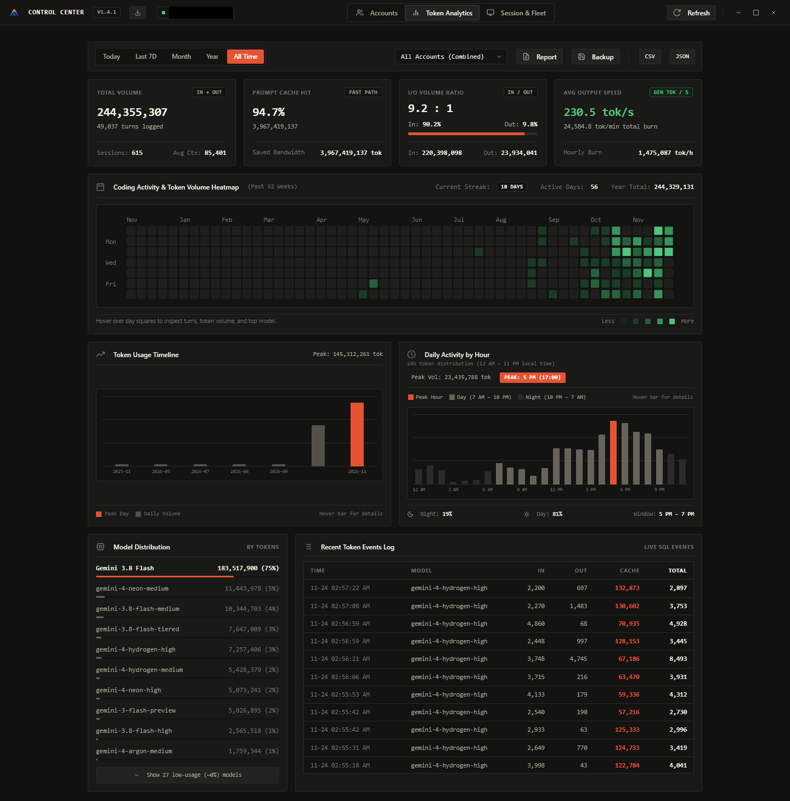
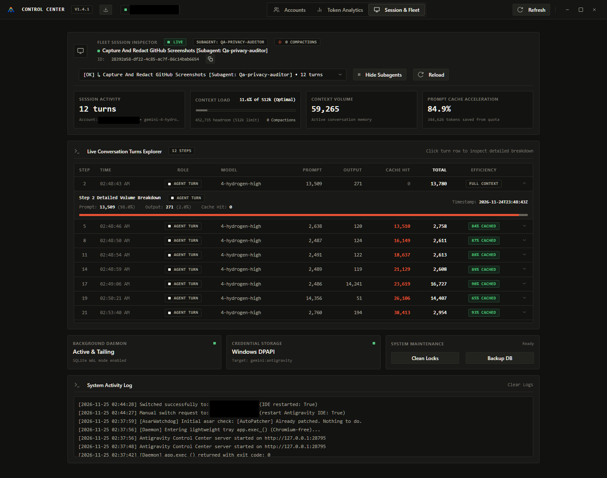

# Antigravity Control Center

**Free, open-source Windows tray app for Google Antigravity IDE — instant multi-account switcher, real-time model quota tracker, token & session analytics, and a live quota pill in the IDE top bar.**

[-2ea44f?style=for-the-badge&logo=windows)](https://github.com/3bdyna/Antigravity-Control-Center/releases/latest)


> **100% local · Windows DPAPI-encrypted credentials · Zero telemetry · SHA-256 verified built-in auto-updater**


*Multi-account overview for Google Antigravity IDE with live 5-hour & weekly quota bars, Windows DPAPI-encrypted storage, smart standby recommendations, and real-time token velocity.*

---

## Why Antigravity Control Center?

Hitting model rate limits mid-session or guessing when your Google Antigravity IDE quotas reset breaks flow. Antigravity Control Center solves that with a lightweight Windows system tray daemon (`~20–30 MB` RAM) and an on-demand `PyQtWebEngine` dashboard that frees **100% of Chromium memory** when minimized back to the tray.

- **Multi-Account Switcher for Google Antigravity IDE:** Switch between multiple Google accounts locally without manual re-login to manage model rate limits. Enroll accounts via browser OAuth or snapshot your active profile from Windows Credential Manager, with credentials encrypted locally using **Windows DPAPI (`AGDPAPI1`)** and atomic writes.
- **Parallel Real-Time Quota Polling & Usage Monitor:** Concurrently track Antigravity model quotas across accounts with local caching (`quotas_cache.json`)—monitoring **5-hour cycle** and **weekly quotas** for **Gemini** and **Claude & GPT**, reset countdowns, smart recommendations (`Active`, `Active (Low)`, `Recommended`, `Cooldown`, `Standby`), and optional **Auto-Pilot** switching.
- **Live Antigravity IDE Top-Bar Integration:** Automatically displays a live quota indicator pill inside the Antigravity IDE titlebar via `AntigravityAsarWatchdog` (`scripts/auto_patch_antigravity.js` & `scripts/antigravity-drag-daemon.js`) whenever Antigravity IDE and Node.js are installed, while keeping Antigravity's official updater cache (`%LOCALAPPDATA%\antigravity-updater`) untouched.
- **Local Token & Session Analytics Dashboard (SQLite):** Background transcript watcher persists token usage into local SQLite (`tokens_history.db`, WAL mode) and streams live updates over local SSE (`127.0.0.1:28795`). Track token volume, prompt cache hit rate, I/O ratio, output speed (`tok/s`), 52-week heatmaps, model breakdowns, and subagent fleets, export to **Executive HTML / CSV / JSON / SQLite**, and auto-detect optional companion MCP/plugin tools (**[`context-mode`](https://github.com/mksglu/context-mode)** and **[`agy-fast`](https://github.com/INK-Q/agy-fast)**).
- **Security & Privacy First:** All credentials are encrypted locally via Windows DPAPI, guarded by a single-instance low-memory tray daemon, and updated via a stdlib-only SHA-256 auto-updater (`updater.py`) with strict HTTPS, trusted-host redirect validation, and `hmac.compare_digest` verification.

---

## Inside the Dashboard

### Token Analytics & 52-Week Heatmaps
Inspect lifetime or per-account usage across **Today**, **Last 7D**, **Month**, **Year**, or **All Time**—including a 52-week coding activity heatmap, token timeline, 24-hour cadence split, model distribution bars, and a live SQL event log.



### Session & Subagent Fleet Inspector
Inspect conversations and background subagent workers turn by turn—monitor context-window headroom before auto-compaction, expand steps for prompt/output/cache breakdowns, check daemon and DPAPI health, and view the system activity log.



---

## Download & Install (Windows 10/11)

### Option A: Windows Installer *(Recommended)*
1. [**Download Latest Windows Installer (.exe)**](https://github.com/3bdyna/Antigravity-Control-Center/releases/latest) (`AntigravityControlCenter-Setup-*.exe`).
2. Run the per-user installer (installs to `%LOCALAPPDATA%\Programs\AntigravityControlCenter\`, no administrator rights required).
3. **Windows SmartScreen:** Because this is an unsigned open-source indie installer, SmartScreen may display *"Windows protected your PC"*. Click **More info** → **Run anyway**.

> [!TIP]
> **No Python or Node.js required:** The installer bundles everything needed for the multi-account switcher, quota monitor, tray daemon, and analytics dashboard. **Node.js** is only needed if you want the optional live Antigravity IDE top-bar quota pill.

### Option B: Run from Source
**Prerequisites:** Windows 10/11, Python 3.10+, and *(optional)* Node.js for the IDE top-bar pill.

```powershell
git clone https://github.com/3bdyna/Antigravity-Control-Center.git
cd Antigravity-Control-Center
pip install PyQt5 PyQtWebEngine
python main.py
```

**CLI Flags:**
- `python main.py --daemon` *(or `--tray`, `--minimized`, `--hidden`)* — Start only the background tray daemon and local `127.0.0.1:28795` API/SSE server.
- `python main.py --ui` — Open the frameless WebEngine dashboard (auto-starts `--daemon` if not running).

### Build Standalone `.exe` Locally

```powershell
pip install pyinstaller
pyinstaller AntigravityControlCenter.spec --noconfirm
```

Output binary: `dist\AntigravityControlCenter\AntigravityControlCenter.exe`.

---

## Optional Companion MCP Tools

Control Center **automatically detects** these optional open-source MCP tools when installed locally and displays live token-savings and batching cards on the dashboard (if not installed, the cards stay hidden):

- **[`context-mode`](https://github.com/mksglu/context-mode)** *(Elastic License 2.0)* — Sandboxes large command outputs and compacts context-window usage to reduce token burn.
- **[`agy-fast`](https://github.com/INK-Q/agy-fast)** *(MIT License)* — Batches search, outlines, multi-file edits, and checks to reduce round-trips.

---

## FAQ & Troubleshooting

<details>
<summary><strong>Where is my data stored, and how are Google credentials protected?</strong></summary>

Everything stays locally in `%USERPROFILE%\.gemini\antigravity-switcher\` (`accounts/`, `quotas_cache.json`, `tokens_history.db`, `autopilot.log`, `app_crash.log`, `updates/`). Account credentials are encrypted at rest with **Windows DPAPI (`AGDPAPI1`)** using atomic file writes—no plaintext tokens touch disk, and no telemetry is sent anywhere. External network calls only contact Google OAuth / Antigravity quota endpoints for your enrolled accounts (plus optional GitHub Releases update checks).

</details>

<details>
<summary><strong>How does the Antigravity IDE top-bar quota pill work, and is it required?</strong></summary>

It is completely optional. When both Google Antigravity IDE and Node.js are installed, `AntigravityAsarWatchdog` runs `scripts/auto_patch_antigravity.js` and `scripts/antigravity-drag-daemon.js` (over CDP) to display a live quota pill in the IDE top bar while preserving `%LOCALAPPDATA%\antigravity-updater`. You can still use the full switcher, quota monitor, and analytics dashboard without Node.js or the patcher.

</details>

<details>
<summary><strong>How does the built-in auto-updater verify downloads?</strong></summary>

`updater.py` uses Python's standard library only. It checks GitHub Releases over HTTPS, enforces `TRUSTED_DOWNLOAD_HOSTS` on every redirect hop, waits for user confirmation, verifies the installer's SHA-256 hash against `SHA256SUMS.txt` using `hmac.compare_digest` before staging, and launches a clean per-user upgrade that preserves `%USERPROFILE%\.gemini\antigravity-switcher\`.

</details>

---

## Architecture

```text
.
├── main.py                        # Entry launcher (delegates to app.main)
├── app.py                         # HTTP/SSE server (:28795), PyQt5 tray daemon, on-demand WebEngine UI, AsarWatchdog
├── switcher.py                    # Parallel quota fetcher, Windows DPAPI (AGDPAPI1) & Credential Manager switcher
├── token_tracker.py               # Transcript watcher, SQLite WAL analytics, heatmap/cadence queries, HTML report
├── updater.py                     # Stdlib-only HTTPS + SHA-256 verified GitHub Releases self-updater
├── version.py                     # App version & user-data/update directory helpers
├── ui_html.py                     # Static asset loader (source & PyInstaller _MEIPASS / _internal layouts)
├── AntigravityControlCenter.spec  # PyInstaller spec bundling app.py, app_icon.ico, and static/
├── installer/                     # Inno Setup 6 per-user installer script
├── static/                        # Frontend UI (index.html, app.js, styles.css, tailwind.css)
├── scripts/                       # Optional Node.js / VBS helpers for app.asar top-bar pill & CDP drag daemon
└── docs/screenshots/              # Redacted README screenshots
```

---

## Inspiration & License

Originally inspired by **[`demusraph/antigravity-control-center`](https://github.com/demusraph/antigravity-control-center)** (MIT License) by `@demusraph`, and expanded with parallel quota polling, SQLite WAL token analytics, session/subagent inspection, an optional `app.asar` top-bar watchdog, and a native installer with SHA-256 verified auto-updates.

Released under the **MIT License** — see [`LICENSE`](LICENSE).
